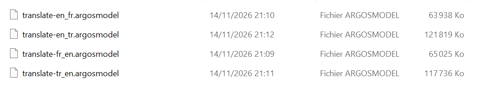

# Explanations about the Downloads folder

After launching the software for the first time, it will download essential language packages needed to run in offline. The language models will be installed and kept in the Downloads folder.

