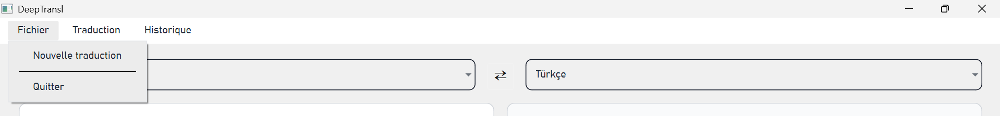
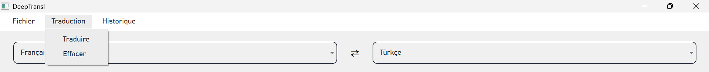
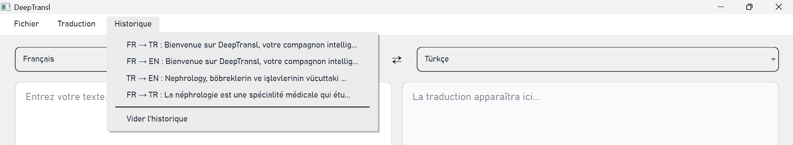

# DeepTransl

Here is an example in a demo of DeepTransl

[https://github.com/user-attachments/assets/bf9e652f-67b9-4c68-89cd-f9817b1daf23](https://github.com/user-attachments/assets/41c5c1ce-f26d-4f21-825d-3c41d5ec21c3)

# Here are some examples of translations and explanations

The menu Fichier (File) helps users make new translations and also quit the software.

The menu Traduction (Traduction) helps users translate without clicking on the button "Traduire" and also clean inputs.

The menu Historique (History) helps users consult the history of all the translations made and also clean the history list.

